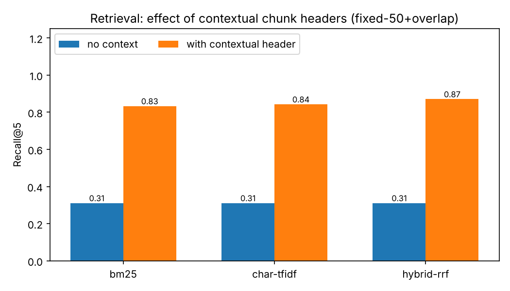
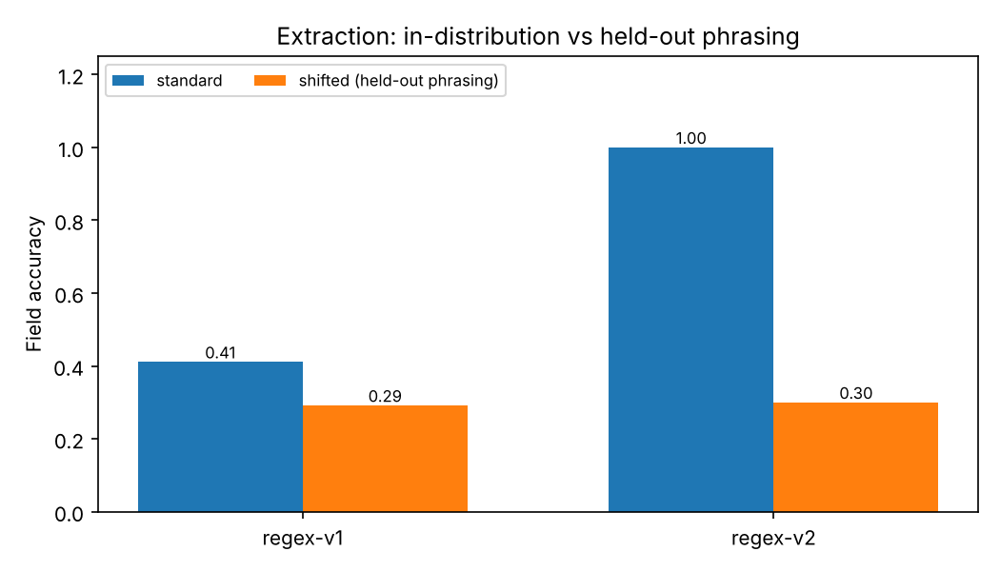

# DocIntel-Eval

**Contract field extraction and cited question answering, built around an evaluation harness that tells you when the system is wrong.**

Most "chat with your documents" demos work on the examples their author tried. This project is built the other way round: a labelled benchmark, ablations for every design choice, a held-out set that exposes overfitting, and a pipeline that **abstains instead of guessing**.

```
$ python scripts/demo.py
Q: What notice period applies to terminating the Cedar Ridge Mining agreement?
   -> notice_days = 90
   source: doc003 chars 1055-1126
   "Either party may terminate this Agreement upon 90 days' written notice."

Q: What is the airspeed velocity of an unladen swallow?
   -> ABSTAINED (could not map question to a known field)
```

## Headline results

60 synthetic contracts, 720 questions, corpus-wide retrieval (every question must find its answer among *all* documents). Full tables: [`results/results.md`](results/results.md).

| Finding | Number |
|---|---|
| Contextual chunk headers: Recall@5 | **0.31 → 0.87** |
| Entity scoping: confident wrong answers (standard set) | **21.9% → 0.0%** |
| Entity scoping: confident wrong answers (held-out set) | **37.5% → 11.7%** |
| Rule-based extractor, tuned on the data | 100% accuracy |
| Same extractor on held-out phrasings | **30%** (the honest number) |
| Query latency (pure Python, CPU) | ~2-3 ms |




## What the harness found (bugs, not just metrics)

The evaluation caught real defects that a handful of manual demos would have missed:

1. **Classifier bug.** A substring match on `"cap"` routed every question about "Falcon **Cap**ital" to the liability-cap extractor (30 of 720 questions). Fixed with word-boundary rules; regression test included.
2. **Wrong-document answers.** The pipeline took the first retrieved chunk that parsed, even from a *different* client with a similar name (e.g. "Cedar Ridge Textiles" vs "Cedar Ridge Mining"): 22% confident errors. Fixed with query-time entity resolution (a metadata filter): **0% on the standard set**.
3. **Chunk-boundary splits.** 50-word windows cut clauses in half. Fixed by merging adjacent retrieved chunks into one span before extraction.
4. **Rank-6-of-7 misses.** The clause chunk ranked below top-k even within the right document. Fixed with field-aware query expansion.

Each fix is a row in the end-to-end ablation table, so its contribution is measured rather than asserted.

## How it works

```
question ──► classify field ──► resolve document (entity match) ──► hybrid retrieval
                                                                    (BM25 + char-ngram TF-IDF, RRF)
        answer + exact-sentence citation  ◄── extract ◄── merge adjacent chunks ◄──┘
        or ABSTAIN → flagged for human review
```

| Module | Purpose |
|---|---|
| `docintel/data.py` | Synthetic contract generator: ground-truth labels, character-level evidence spans, phrasing/format variation, look-alike distractor clauses, and a `shifted=True` held-out mode |
| `docintel/chunking.py` | Fixed-window, overlapping-window and paragraph chunkers; contextual headers; evidence-span relevance |
| `docintel/retrieval.py` | BM25, char-n-gram TF-IDF, reciprocal-rank-fusion hybrid (all from scratch, no dependencies) |
| `docintel/extraction.py` | `regex-v1` baseline, `regex-v2` sentence-scoped extractor, optional `LLMExtractor` |
| `docintel/pipeline.py` | End-to-end QA with abstention and citations |
| `docintel/evaluation.py` | Recall@k, MRR, accuracy/precision/recall/F1, wrong-vs-abstain rates, latency |
| `docintel/api.py` | FastAPI wrapper (`/extract`, `/ask`, `/health`) |

## Quickstart

```bash
git clone https://github.com/YOUR-USERNAME/docintel-eval.git
cd docintel-eval

python -m unittest discover -s tests -v   # 27 tests, stdlib only
python scripts/run_eval.py                 # reproduces every number above
python scripts/demo.py                     # live Q&A with citations

# HTTP API (optional)
pip install -r requirements.txt
uvicorn docintel.api:app --reload          # docs at http://127.0.0.1:8000/docs
```

The core pipeline and benchmark have **no third-party dependencies**.

## Use it on your own documents

**Serve and query them:** put `.txt` files in a folder and run
`DOCINTEL_DOCS_DIR=/path/to/folder uvicorn docintel.api:app`.

**Benchmark on them:** build `Doc` objects (see `docintel/data.py`) with your own `gold` values and `evidence` character spans, then call `retrieval_eval`, `extraction_eval` and `e2e_eval`. The harness is the product: it tells you which extractor, chunking strategy and retriever actually wins on *your* data.

**Compare against an LLM:** the extractor interface is `text -> {field: value}`, so an LLM is a drop-in.

```bash
pip install anthropic && export ANTHROPIC_API_KEY=...
python scripts/run_eval.py --llm --price-in <USD/Mtok> --price-out <USD/Mtok>
```

This adds an `llm` row to every extraction table and prints an estimated cost per 1,000 documents.

## Limitations (read before citing any number)

- **Synthetic data.** The corpus is generated, so absolute numbers say nothing about real contracts. Its purpose is a reproducible, fully labelled testbed for comparing methods and catching bugs.
- **The 100% scores are optimistic by construction.** `regex-v2` and the query-expansion hints were written after seeing the generator's phrasings. The `shifted` set (unseen date formats, number formats and clause wordings) is the honest generalisation estimate: rules fall to 30% with 11.7% confident errors. That gap is exactly why rules alone do not ship to production.
- **LLM extractor is implemented but not benchmarked here.** It was tested with a fake backend (response parsing, validation, malformed output) but I have not run it against a live model, so the repository reports no LLM accuracy. Running `--llm` produces the comparison.
- **Retrieval is lexical only.** Paraphrased questions score lower than lexical-overlap ones (Recall@5 0.82 vs 0.92). A dense or reranker stage is the obvious next step and the harness is ready to measure it.
- **Entity scoping assumes the question names the client.** If it does not, the pipeline falls back to unscoped retrieval (the measurably worse mode).
- The FastAPI layer and Dockerfile are thin wrappers; the tests cover the service layer beneath them.

## Roadmap

- [ ] Dense retriever + cross-encoder reranker, ablated in the same table
- [ ] Benchmark on a real public corpus (e.g. CUAD contracts)
- [ ] Fine-tuned small-model extractor vs frontier LLM: accuracy / cost / latency
- [ ] Confidence calibration for abstention thresholds
- [ ] PDF/DOCX ingestion

## License

MIT
